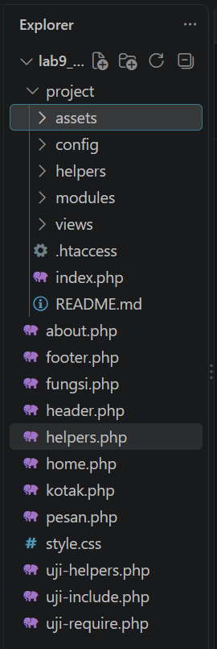
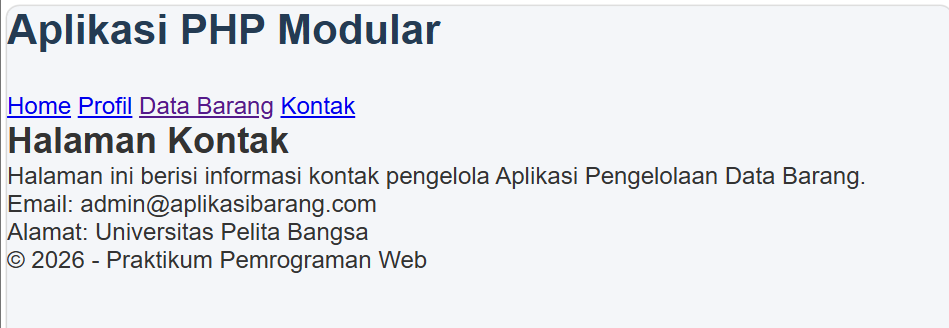
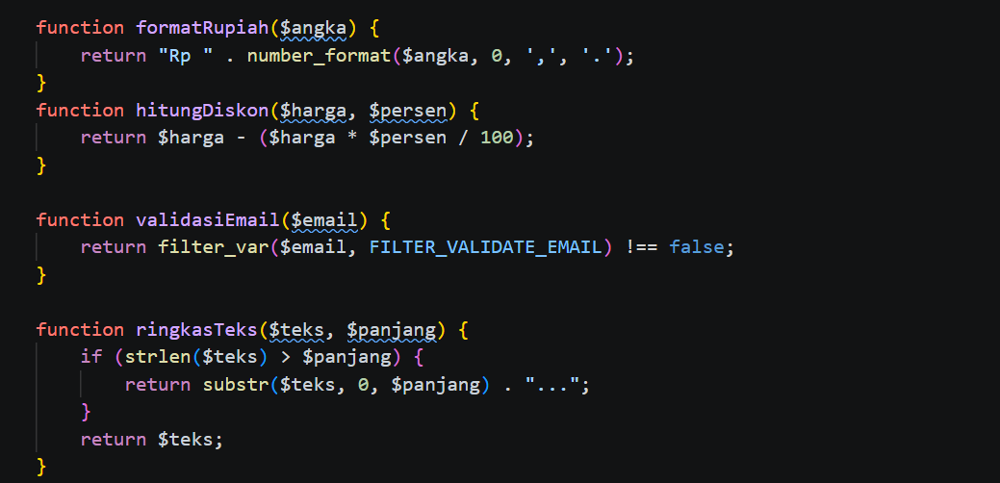
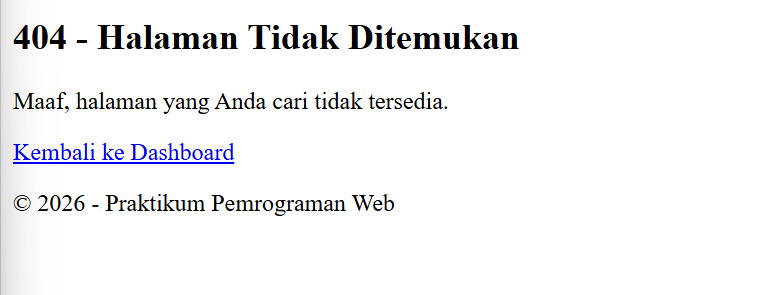
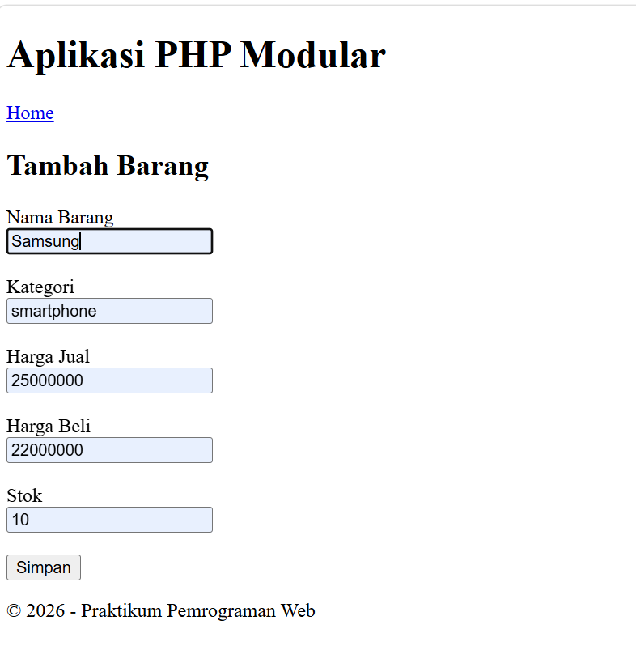
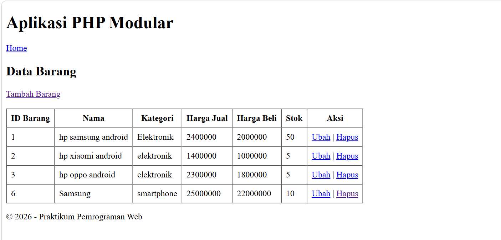
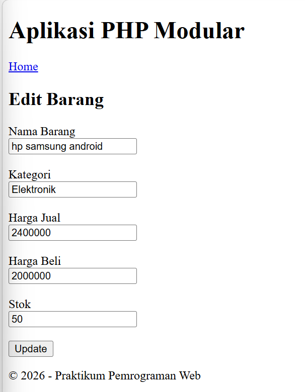
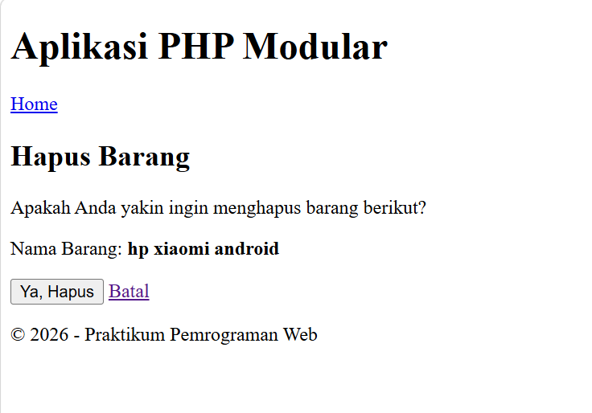
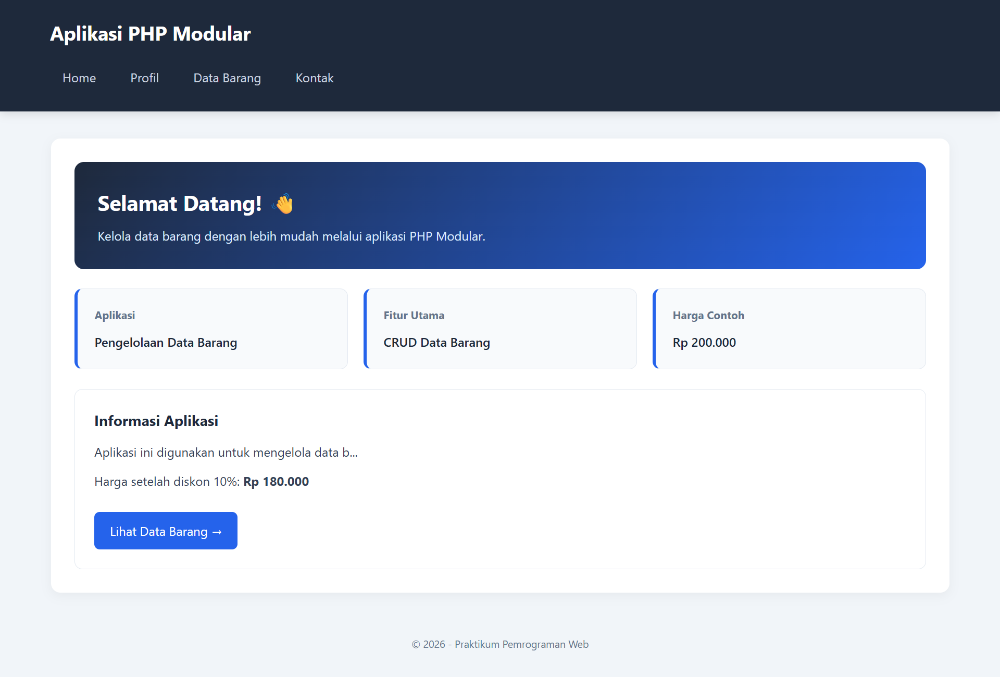

# PRAKTIKUM 9 – PHP MODULAR

## A. Identitas

- Nama: Nabila Eka Suwarno
- NIM: 312510399
- Program Studi: Teknik Informatika
- Fakultas: Teknik
- Universitas: Universitas Pelita Bangsa
- Mata Kuliah: Pemrograman Web

## B. Deskripsi Project

Praktikum ini membahas penerapan konsep PHP Modular dalam membangun aplikasi web dengan kode yang lebih terorganisasi, mudah dikelola, dan dikembangkan.

Project yang dibuat adalah aplikasi pengelolaan data barang berbasis web menggunakan PHP dan MySQL. Aplikasi ini memiliki fitur CRUD (Create, Read, Update, Delete), sistem navigasi, template multi-halaman, helper functions, routing, serta pembatasan akses menggunakan session login.

## C. Tujuan Praktikum

1. Memahami konsep modularisasi dalam pemrograman PHP.
2. Memahami pemisahan konfigurasi, tampilan, fungsi bantuan, dan modul aplikasi.
3. Menerapkan sistem routing menggunakan whitelist.
4. Mengimplementasikan operasi CRUD pada aplikasi.
5. Menerapkan session login dan pembatasan akses.
6. Menggunakan URL Rewrite untuk membuat alamat halaman lebih sederhana.

## D. Perangkat dan Teknologi yang Digunakan

### 1. Perangkat Keras (Hardware)
- Laptop/Komputer

### 2. Perangkat Lunak (Software)
- Sistem Operasi Windows
- XAMPP
- Visual Studio Code
- Google Chrome
- Mozilla Firefox

### 3. Bahasa Pemrograman dan Teknologi
- PHP
- HTML
- CSS
- MySQL
- Apache

## E. Struktur Direktori

## F. Langkah dan Hasil Praktikum

### 1. Template Multi-Halaman

Membuat beberapa halaman, seperti Dashboard, Profil, dan Kontak menggunakan template header dan footer yang digunakan bersama.

### 2. Library Functions

Membuat fungsi bantuan (helper functions) agar dapat digunakan kembali pada beberapa halaman aplikasi

### 3. Router Aman

Menerapkan sistem routing menggunakan daftar halaman yang diizinkan (whitelist). Router juga menyediakan halaman 404 untuk alamat halaman yang tidak ditemukan.

### 4. Refactoring CRUD

Mengembangkan aplikasi pengelolaan data barang dengan menerapkan empat operasi CRUD:

- Create: Menambahkan data barang.

- Read: Menampilkan data barang.

- Update: Mengubah data barang.

- Delete: Menghapus data barang.

### 5. Tampilan Antarmuka

Memperbaiki tampilan aplikasi menggunakan CSS agar lebih rapi, menarik, dan responsif.

## G. Tantangan Mandiri

### 1. Active Navigation

Menambahkan penanda pada menu navigasi untuk menunjukkan halaman yang sedang aktif sehingga pengguna dapat mengetahui posisi halaman yang sedang dibuka.

### 2. Helper Flash Message

Membuat notifikasi untuk memberikan informasi ketika proses tambah, ubah, dan hapus data berhasil atau gagal.

### 3. Access Restriction

Menerapkan pembatasan akses pada halaman Data Barang menggunakan session login. Pengguna harus melakukan login terlebih dahulu sebelum dapat mengakses halaman tersebut.

Akun pengujian:

- Username: `admin`
- Password: `admin123`

### 4. URL Rewrite

Menggunakan file `.htaccess` untuk membuat alamat halaman lebih sederhana tanpa harus menuliskan `index.php?page=`.

Contoh alamat:

- `http://localhost/lab9_php_modular/project/dashboard`
- `http://localhost/lab9_php_modular/project/profil`

## H. Daftar Rute Aplikasi

| Halaman | Parameter |
|---|---|
| Dashboard | `?page=dashboard` |
| Profil | `?page=profil` |
| Kontak | `?page=kontak` |
| Data Barang | `?page=barang/list` |
| Tambah Barang | `?page=barang/add` |
| Edit Barang | `?page=barang/edit&id=1` |
| Hapus Barang | `?page=barang/delete&id=1` |
| Login | `?page=auth/login` |
| Logout | `?page=auth/logout` |

## I. Pengujian Aplikasi

Pengujian dilakukan melalui browser menggunakan localhost. Hasil pengujian menunjukkan bahwa:

1. Halaman Dashboard, Profil, dan Kontak dapat dibuka.
2. Fitur CRUD data barang dapat dijalankan.
3. Notifikasi berhasil ditampilkan setelah operasi tambah, ubah, dan hapus.
4. Navigasi aktif dapat ditampilkan.
5. Proses login dan logout dapat dijalankan.
6. Halaman Data Barang tidak dapat diakses ketika pengguna belum login.
7. URL Rewrite berhasil digunakan untuk mengakses halaman Dashboard dan Profil.

## J. Pertanyaan Pemahaman

### 1. Jelaskan pengertian modularisasi program dan minimal tiga manfaatnya.

Modularisasi program adalah teknik membagi program menjadi beberapa bagian atau modul berdasarkan fungsi dan tugas tertentu.

Manfaat modularisasi:
- Memudahkan pengelolaan dan pemeliharaan kode.
- Memudahkan penggunaan kembali kode.
- Mempermudah proses pencarian dan perbaikan kesalahan.
- Membuat struktur program lebih terorganisasi.

### 2. Apa perbedaan include dan require ketika file yang dipanggil tidak ditemukan?

`include` akan menghasilkan peringatan (warning), tetapi program masih dapat melanjutkan proses. Sedangkan `require` akan menghasilkan kesalahan fatal sehingga program berhenti dijalankan.

### 3. Mengapa require_once sesuai digunakan untuk memuat konfigurasi database?

Karena `require_once` memastikan file konfigurasi database hanya dimuat satu kali meskipun dipanggil dari beberapa bagian program. Hal ini membantu menghindari pemuatan ulang file secara berulang.

### 4. Jelaskan perbedaan parameter, argumen, dan nilai return pada function.

- Parameter adalah variabel yang dituliskan pada saat deklarasi function.
- Argumen adalah nilai yang diberikan ketika function dipanggil.
- Return adalah nilai yang dikembalikan oleh function setelah menjalankan prosesnya.

### 5. Mengapa header dan footer sebaiknya dipisahkan dari konten halaman?

Agar tampilan yang digunakan bersama tidak perlu ditulis berulang kali pada setiap halaman. Selain itu, perubahan header atau footer dapat dilakukan pada satu file saja.

### 6. Apa fungsi index.php pada pola routing yang dipraktikkan?

`index.php` berfungsi sebagai pintu masuk utama aplikasi yang menerima parameter halaman, memeriksa rute, dan menentukan file halaman yang harus ditampilkan.

### 7. Mengapa router sebaiknya menggunakan whitelist rute?

Agar hanya halaman yang sudah didaftarkan dan diizinkan yang dapat diakses. Hal ini membantu meningkatkan keamanan aplikasi dan mencegah akses ke file yang tidak seharusnya dibuka.

### 8. Apa risiko jika input page langsung digabungkan menjadi path file yang di-require?

Risikonya adalah pengguna dapat memanipulasi parameter untuk mencoba mengakses file di luar direktori aplikasi. Hal tersebut dapat menimbulkan celah keamanan seperti Path Traversal dan pemanggilan file yang tidak diizinkan.

### 9. Apa fungsi aturan RewriteCond dan RewriteRule pada .htaccess?

`RewriteCond` digunakan untuk menentukan kondisi sebelum aturan penulisan ulang URL dijalankan. Sedangkan `RewriteRule` digunakan untuk mengubah atau mengarahkan URL sesuai pola yang ditentukan.

### 10. Sebutkan bagian aplikasi CRUD yang paling tepat dipindahkan ke config, views, helpers, dan modules.

- Config: Menyimpan konfigurasi database dan pengaturan aplikasi.
- Views: Menyimpan tampilan halaman seperti header, footer, dan dashboard.
- Helpers: Menyimpan fungsi bantuan yang dapat digunakan kembali, seperti format Rupiah.
- Modules: Menyimpan proses utama aplikasi CRUD, seperti tambah, tampil, ubah, dan hapus data barang.

## K. Kendala dan Cara Mengatasinya

| Kendala | Cara Mengatasi |
|---|---|
| Kesalahan penulisan kode PHP | Memeriksa kembali sintaks dan memperbaiki kode yang salah. |
| File tidak ditemukan | Memeriksa lokasi file dan menggunakan `__DIR__` untuk membentuk path. |
| Halaman tidak ditemukan | Memeriksa parameter dan daftar rute pada router. |
| Notifikasi tidak muncul | Memeriksa session dan pemanggilan fungsi flash message. |
| Pembatasan akses belum berjalan | Memperbaiki proses login dan logout menggunakan session. |
| URL Rewrite tidak berjalan | Memeriksa konfigurasi Apache dan file `.htaccess`. |

## L. Kesimpulan

Berdasarkan praktikum yang telah dilakukan, penerapan konsep PHP Modular membantu membuat aplikasi web dengan kode yang lebih terorganisasi dan mudah dikembangkan. Penggunaan template, helper functions, router, CRUD, session login, flash message, dan URL Rewrite memberikan pemahaman mengenai pengembangan aplikasi web menggunakan PHP secara modular.